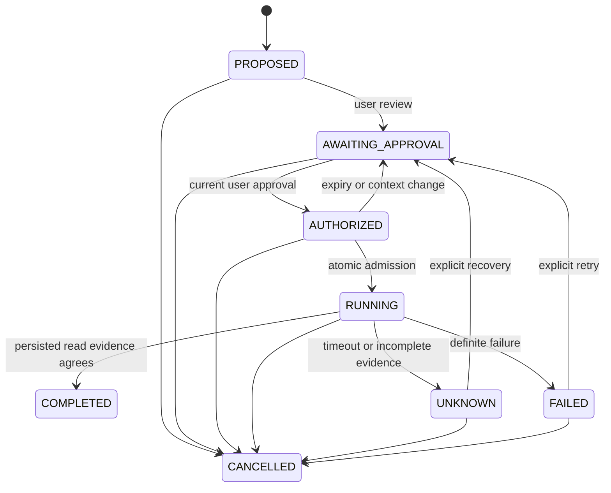

# Execution, evidence and recovery

## Surface and ownership

The existing Twin application and memory engine remain intact. `GET /api/assurance` lists the signed-in account's priorities and workflows. `POST /api/assurance` accepts a strict discriminated command: `propose`, `review`, `approve`, `execute`, `cancel`, `resume`, `reconcile`, `supersede`, or `priority`. There is no `complete` endpoint and no model-callable workflow mutation tool.

Every request uses P0-001's verified identity and owner authorization. The server obtains generation and epoch from D1. A workflow's intent, plan, source references, dependencies and deadline are immutable; correcting the plan means superseding it and creating a new proposal. User priority and project importance can be overridden without becoming execution authority.

The Activity tab contains the Trust Center. The initial UI proposes local memory searches; the API also supports model-directed reads of the existing five tools. Both explicitly describe completion as a context check. Preparing context for an investor follow-up does not mean writing, sending or delivering that follow-up. The model path returns executor-supplied evidence and discards model prose.

## State machine

`COMPLETED` and `CANCELLED` cannot resume. Expiry, partial execution, supersession and reconciliation requirements are explicit reason codes. Execution attempts are limited to three. The original per-account request quotas still apply; a retry can be rate-limited.

Each transition stores owner, generation, workflow ID, monotonic version, previous/new state, time, authoritative actor category, authorization/run references, reason and a server-generated correlation ID. D1 `batch()` commits a guard, optional authorization/outcome and transition together. SQL triggers enforce the transition graph and generate history. Concurrent requests cannot both increment the same expected version.

## Durable checkpoint and authority

The checkpoint stores a small versioned plan and references, not a chat transcript, model output or reusable login token. Its checksum detects accidental/cross-record corruption. It is not an independent signature. The current schema has no editing operation for the checkpoint; a changed intention is a new workflow.

Approval binds the account generation, current context epoch and exact plan hash. It expires after at most five minutes, the user's JWT expiry or workflow deadline. Provider reads additionally require current context-sharing consent. Changes to personal context/consent increment the existing epoch and atomically move `AUTHORIZED` to review or `RUNNING` to `UNKNOWN`. Cancel invalidates the live run. Erasure cascades workflows, authorizations, history and outcomes; a new account generation cannot reuse old work.

On resume the engine verifies identity, generation, checkpoint, workflow deadline, prior receipts and attempt count. A still-live execution lease produces a conflict rather than starting a parallel attempt. An expired running lease becomes `UNKNOWN`; a user must review and approve before a new read. Divergent evidence prevents retry until investigated. No consequential external action exists or is replayed.

Browser refresh and Worker restart need no in-memory execution state. An actual local workerd isolate replacement is tested while D1 persists. A browser/network interruption does not necessarily cancel remote computation. The pinned Worker compatibility date predates automatic client-disconnect signals; enabling `enable_request_signal` is a staging decision, not a production change made here. Explicit persistent cancellation and SQL deadlines are the authority boundary.

## Reconciliation and trust limits

The existing `agent_runs` and `agent_execution_receipts` remain the execution records. New workflow authorizations, events and outcome manifests supplement them. Completion requires a completed owner/generation-bound run, matching plan/authorization/epoch, in-window timestamps, the expected successful receipts, and an atomically persisted outcome digest.

| Conclusion | Meaning |
|---|---|
| VERIFIED | Records establish the defined bounded context read. It does not certify the truth of the returned content or an external action. |
| DIVERGENT | Plan/authority, receipt fields, outcome digest or transition history contradict one another. |
| CANNOT_PROVE | A run, receipt, successful status or persisted outcome is absent/incomplete. |

Diagnostics are never a fallback for missing receipts. Model text is never a completion authority. Checksums/hashes do not prove independence from a compromised Worker or D1 administrator. No cryptographic signing key was introduced.

## Failure handling

- A receipt start failure prevents the tool from running. A receipt completion failure discards the result.
- A final outcome write failure rolls back the completed transition and leaves unresolved work.
- If D1 cannot persist even an unresolved transition, the API fails; the previous `RUNNING` checkpoint remains recoverable after its lease expires. It does not fabricate a stored `UNKNOWN` record.
- Timeouts and partial execution never complete a workflow. Bounded reads can be retried only through review and current approval.
- Account deletion during execution cannot recreate old-generation receipts. Consent/context changes suppress stale results.
- A corrupt checkpoint or divergent receipt history requires investigation or cancellation/supersession, not automatic repair.
- Restoring an old backup can resurrect erased data. Reconcile the deletion ledger and retention policy before any operational restore; this is a hosted operational gate.

## Observability schema

`TWIN_DIAGNOSTICS=1` enables capped request-local spans (96 maximum). Without it, no diagnostic spans/export are generated. Server-generated trace IDs correlate with transition history; model transports propagate only a fresh `traceparent`. Incoming public IDs are parsed then replaced; baggage/tracestate are dropped.

Span categories cover admission, identity, authorization, memory retrieval, deterministic planning, model invocation, tool validation/execution, receipt persistence, transitions, cancellation, recovery and reconciliation. Metadata is restricted to operation category, registered tool name, duration, closed error code, outcome and valid numeric token counts. Estimated monetary cost remains `null` unless independently priced; none is invented from token counts.

No memory content, user/account ID, email, prompt, model text, exception detail, credential or authorization token enters these diagnostic attributes. Optional `TWIN_OTLP_ENDPOINT` must be a server-configured HTTPS URL without embedded credentials/query/fragment; `TWIN_OTLP_TOKEN` stays in the request header. Export is best-effort with a 500ms timeout, no redirect following, no retries. Native `ctx.tracing` is feature-detected. Automatic Cloudflare logs/traces are separate and still require hosted privacy inspection.

This is a small explicit OTLP-compatible subset, not an installed OpenTelemetry SDK or a deployed observability service. The optional exporter is disabled by default.
