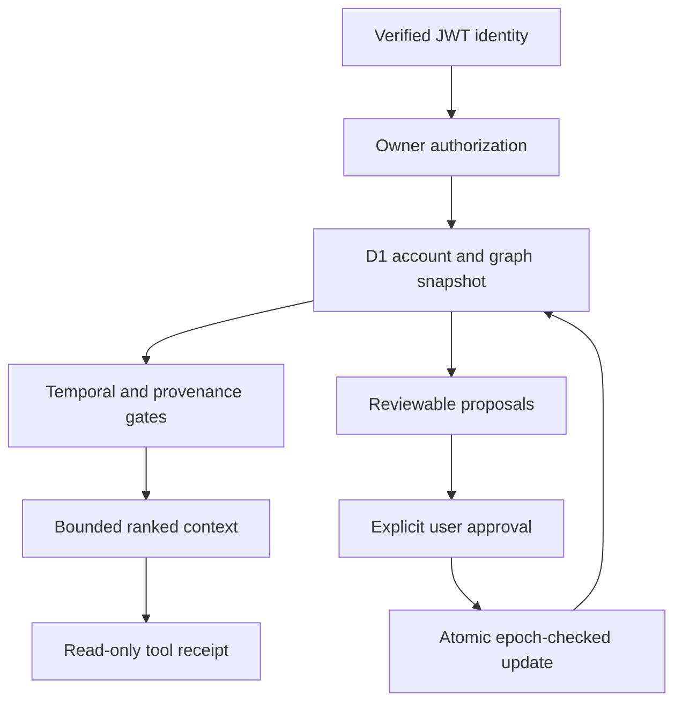

# JARVIS P0-003 — research and architecture

Evidence collected 7 November 2026 (UTC). This is a private-alpha implementation, not a claim of deployed security or general human-level memory. The authoritative store is D1. No additional memory server, vector database, model service, or runtime dependency was added.

## Repository decision

Base: `security/jarvis-p0-001-verified-identity`, commit `cf0691e0786acd399d7ec12d6f071409caf5713c`, [PR #1](https://github.com/richardrich999888-rgb/FOUNDER-OS/pull/1). This was locally verified; external reviewer approval and hosted login verification remain outstanding.

P0-002 exists on `claude/tender-bohr-5mk04u`, commit `697d40703038f5b42eda619daac6aae22668e907`, [draft PR #2](https://github.com/richardrich999888-rgb/FOUNDER-OS/pull/2). The branch advanced during this task to `a90b17420ec59d494b255f9da01ace7354a1a34c` (grounding labels/tests only); the principal and lifecycle boundaries are unchanged. It is based on the earlier Twin prototype, not P0-001. Importing that tree would discard the verified identity modules. Its principal constructor accepts an ordinary user object and scopes; receipt/account deletion lacks a shared generation boundary. It was not incorporated at the original P0-003 delivery. The [2026-11-08 remediation](blocker-remediation.md) now selectively incorporates provider-neutral runtime modules, with new registered principals, current-context checks and generation-bound receipts. A deterministic local planner exercises the actual runtime. Its OpenAI adapter and live-model orchestration remain outside this integration; no live model run is claimed.

## Open-source inspection

Repositories were shallow-cloned and their README, license, package manifests and relevant source inspected at the following immutable revisions. Patterns informed this implementation; no cryptography or memory-server code was copied. Existing `jose` 6.2.14, Drizzle 0.45.2 and Zod 3.25.x remain the actual security/storage/validation libraries.

| Project / revision                                                                                           | Source inspected and useful pattern                                                                                            | License at inspected revision | Twin runtime decision                                                                                                                                          |
| ------------------------------------------------------------------------------------------------------------ | ------------------------------------------------------------------------------------------------------------------------------ | ----------------------------- | -------------------------------------------------------------------------------------------------------------------------------------------------------------- |
| [Mem0](https://github.com/mem0ai/mem0/tree/f1791daa86d469249c9b002f62644d58a1eb96a0)                         | `mem0/memory/main.py`: infer/add, search, update/delete and history; separate extraction from durable memory                   | Apache-2.0                    | Python, model and vector-store infrastructure. Reuse proposal/update separation, not a server dependency.                                                      |
| [Graphiti](https://github.com/getzep/graphiti/tree/747b480ec6b12ecb718f1e2bc588b20ee36ea9c2)                 | `graphiti_core/edges.py`, edge maintenance: valid/invalid/expired timestamps and provenance                                    | Apache-2.0                    | Python graph drivers and model dependencies do not fit this Worker without a separate service. Implement a bounded D1 temporal graph.                          |
| [Letta](https://github.com/letta-ai/letta/tree/8816d3a8516893bfdc0fa14bfb1235226012e295)                     | Current root is a documentation pointer; followed its source link to Letta Code                                                | Apache-2.0                    | Do not assume the old Python server remains at this revision.                                                                                                  |
| [Letta Code](https://github.com/letta-ai/letta-code/tree/9176d8c0b16f408e9240422a98379a423e2176c3)           | `src/agent/memory-runtime.ts`, `src/memory-confinement.ts`: scoped memory and fail-closed confinement delegation               | Apache-2.0                    | Bun/Node CLI, process/filesystem and native PTY capabilities are unsuitable as a Worker dependency. Keep D1 ownership enforcement.                             |
| [LangMem](https://github.com/langchain-ai/langmem/tree/8620b986af5b0c7593e6b7fbece2998690d22d15)             | `src/langmem/knowledge/extraction.py`: typed extraction and memory consolidation through a store                               | MIT                           | Python LangGraph/LangChain stack not embedded. Adopt validated proposals; never let learned prompts alter authority.                                           |
| [Hindsight](https://github.com/vectorize-io/hindsight/tree/0bd55015393d224deec1073d63b24bcc0faad164)         | `hindsight-api-slim/hindsight_api/engine/memory_engine.py`: retain/recall/reflect, temporal/entity links, operation validators | MIT                           | Python, asyncpg/PostgreSQL and model-backed service; no measured advantage here justifies deploying it. Keep fact/outcome separation and source checks.        |
| [OpenAI Agents JS](https://github.com/openai/openai-agents-js/tree/252236c32d30010ef974db77395e19dfb03bbeff) | Cloudflare integration package, `examples/memory/memory-hitl.ts`, sessions and tool approval                                   | MIT                           | Worker-compatible portions exist. Defer SDK adoption until the P0-002 registry/principal/receipt contract is verified; no need for a second agent runtime now. |

License observations are repository-specific snapshots, not assurances about optional models, datasets, hosted terms, or every transitive dependency. No new runtime dependency or copied upstream source requires an additional notice in this patch.

## Research implications

- [Stanford Generative Agents](https://arxiv.org/abs/2304.03442): memory, reflection and planning motivate distinct records and retrieval. Simulated-agent behavior does not prove personal-data accuracy or authorize autonomous actions.
- [Berkeley MemGPT](https://arxiv.org/abs/2310.08560): hierarchical memory motivates separating durable storage from bounded model context. D1 remains authoritative; the context is a disposable projection.
- [Princeton-affiliated Reflexion](https://arxiv.org/abs/2303.11366): feedback can improve future attempts without weight changes. Twin stores user-attested outcomes and proposes checklists; it does not self-modify prompts, code or permissions.
- [MIT/SMART-affiliated MEM1](https://mit-mi.github.io/mem1-site/): compact evolving internal state motivates bounded context. Its trained-policy results are not reproduced by this deterministic TypeScript implementation; no reinforcement-learning training is claimed.
- [Microsoft Research PlugMem](https://www.microsoft.com/en-us/research/publication/plugmem-a-task-agnostic-plugin-memory-module-for-llm-agents/): structured propositional/prescriptive knowledge motivates separating facts from procedures and retrieving relevant evidence rather than a raw transcript.
- Temporal graphs: Graphiti's source supplies explicit validity patterns. Twin retains creation/modification and validity intervals plus approved supersession records. It does not implement Graphiti's full temporal reasoning.
- Selective forgetting is implemented as source/dependency invalidation and active-store scrubbing, not model-weight unlearning. No training or embeddings contain user memory in this version.

These are architectural inferences, not reproduced academic results.

## Architecture

`lib/intelligence/model.ts` defines strict discriminated records for sources, entities, facts, relationships, commitments, procedures, outcomes and revisions. Every stored row has owner, account generation, UUID, source reference, timestamps, confirmation, validity, privacy and version. Sources reference themselves. No external write takes an owner ID or model-supplied principal.

`0001_persistent_intelligence.sql` preserves existing account IDs, state JSON and version. It adds a random account generation, graph head/epoch, records, dependencies, mutation guard and minimal tool receipts. An account deletion cascades graph/receipts. Reinitializing the same user receives a new generation, preventing stale writes from matching a reset version. The hand-authored SQL includes triggers and deferred source FKs not expressible by Drizzle's generated snapshot; keep those explicit SQL clauses during future migrations. P0-002 has a different migration numbered 0001. The reconciliation is now `0002_verified_agent_runtime.sql`; do not apply the competing upstream 0001. Existing 0000/0001 and their guards are retained.

Read snapshots use `D1.batch` across account state, graph and dependency reads. Writes use an epoch-checked guard and one atomic batch; the guard increments the epoch and any statement failure rolls the batch back. Legacy JSON edits advance the epoch and atomically scrub affected imported sources and descendants. No migration imports, confirms or rewrites a user's existing memories.

## Extraction and review

English deterministic patterns cover `Person:`, `Organization:`, `Project:`, `I prefer`, `I decided to … because …`, `My goal/routine is`, `I will/promise to/committed to`, `Relationship: name | association | name`, and `Procedure: title | step > step`. Relationships resolve only unique, exact confirmed entity names/aliases. Unresolved relationships produce no invented edge. Commitment names are preserved verbatim and only linked when uniquely resolved at confirmation. Incomplete names and ambiguous deadlines require review. A deadline requires an explicit ISO timestamp/offset and valid IANA timezone; relative text stays unresolved.

Optional structured extraction output can be submitted through the same strict Zod boundary. This version makes **no extraction model call**. Exact source spans prove attribution, not truth or entailment. Every new claim is proposed; a user must review and confirm it. Instructions inside source text never become executable operations. Semantic paraphrases, broad multilingual extraction, fuzzy entity merges and implicit date resolution are not implemented.

Contextual facts can be entered directly with source evidence. Same-type, same-property-key, same-subject conflicting facts require approval of all detected supersessions; exact duplicates are flagged. Automatic extraction supplies only a small set of deterministic preference keys, not a general semantic contradiction detector. Archived superseded facts remain visible for review and explicit forgetting, but never enter current model context.

## Retrieval and commitments

Pipeline: verified identity → bounded owner snapshot → temporal/privacy/provenance/dependency gates → lexical/structured candidates → ranking → at most five results within a 16,000-character result-content budget. No cross-account query or result cache exists. One-hop entity relationships and explicit since/until filters are supported; `since` filters modification time and `until` creation time. These are recorded-observation timestamps, not inferred historical event dates. Current retrieval excludes superseded facts; the review view preserves revision history.

Commitments follow proposed → confirmed → active → completed/cancelled, with optional person/project, deadline/timezone, next action and source. Completion requires an explicitly selected confirmed successful outcome, labelled **user-attested**, not independently verified execution. Follow-up drafts are local text and never send communications. Structured filters support overdue, no-deadline, person, project and follow-up questions. General natural-language calendar interpretation is not promised.

The existing Memory view is extended, not replaced. Legacy routes and data remain usable. Explicit legacy import creates proposals and leaves the original untouched. While an import is only proposed, previously usable legacy context stays available. After review, lines covered by graph proposals are excluded from legacy fallback so a superseded original cannot reappear; unrelated lines remain verbatim legacy passages. A legacy edit invalidates its prior graph representation; re-import is explicit. Existing deterministic chat uses eligible new memories; live AI additionally revalidates generation/epoch/consent before provider disclosure and before returning an answer.

## Controlled learning and tools

Three distinct, confirmed, positive user-attested outcomes with identical normalized steps can propose a reusable procedure. Confirmation and activation are separate operations. Learned steps are a checklist, never authority or automatic execution. Negative/unreviewed outcomes do not activate a procedure. Deleting any supporting evidence invalidates the dependent procedure. Outcome feedback is not an external execution proof.

The standalone adapter supports `search_personal_memory`, `find_commitments`, `get_person_context`, `get_project_context`, `retrieve_procedure`. A trusted server composition root issues an opaque in-process capability tied to a real P0-001 Identity, explicit tool subset, consent, account generation, at most five calls, and at most 60 seconds/identity expiry. JSON copies and model-authored grants fail. Calls use typed arguments, owner reads and minimal D1 receipts; failing receipt writes fail closed. Receipt completion rechecks epoch/generation/consent. The integrated runtime now revalidates the context before every planner disclosure, after tool completion, before final receipt persistence and after its await. A live provider adapter must preserve these gates. A successful read receipt does not prove an agent action or grant lasting access.

## Bounds, latency and cost

Private-alpha caps: 1,000 records per account **including sources/tombstones**, 8,000 dependency rows, 20 candidates per capture, 16,000-character sources, five context results, one relationship hop and 32 dependency levels. Reads currently hydrate the bounded account graph: O(records + dependencies), not a claimed large-scale graph engine. The owner/status index supports future narrowing. No background consolidation, external scheduler, durable queue, full vector search, or automatic tombstone compaction runs.

[Cloudflare D1 transactions](https://developers.cloudflare.com/d1/observability/find-expensive-queries/) document batch rollback semantics. [D1 limits](https://developers.cloudflare.com/d1/platform/limits/) and [pricing](https://developers.cloudflare.com/d1/platform/pricing/) require budgeting reads, writes and storage, rather than assuming free operation. As observed, free allowances include 5M rows read/day, 100k rows written/day and 5GB storage; billable production use was not measured. Hydrating every account record will become expensive before this is a large-account design.

The optional [Workers AI BGE base model](https://developers.cloudflare.com/workers-ai/models/bge-base-en-v1.5/) returns 768-dimensional embeddings with a 512-token input limit; published model price was about $0.0666/M input tokens. [Vectorize pricing](https://developers.cloudflare.com/vectorize/platform/pricing/) bills stored and queried dimensions; [limits](https://developers.cloudflare.com/vectorize/platform/limits/) include 1,536 dimensions and 10KiB metadata per vector. Neither service was provisioned or benchmarked: there are no authorized test bindings/credentials. Optional semantic results are explicitly **not measured**, not estimated from vendor marketing.

Adoption gate: run the frozen dataset plus an independent, consented corpus; demonstrate an incremental retrieval benefit at measured p50/p95 latency and billable cost; retain D1 owner/version/provenance post-filtering; prove deletion of indexed vectors and stale-index rejection. Vector metadata is never an authorization boundary. Current measured results and limitations are in [benchmark report](benchmark-report.md).

## Deletion and privacy boundary

Forgetting uses the **source** as the deletion unit. It scrubs the source and all facts/relationships/procedures derived from that evidence, even when several records came from one note. The UI explicitly warns about this breadth. Tombstones retain IDs and timing only. Account deletion removes active records/receipts transactionally. Correcting/deleting imported legacy data invalidates derived copies in the same SQL transaction. There are no embeddings, summaries, indexes with copied text or server result caches to resurrect it.

Security logs contain only fixed event/action/outcome, random decision ID and time; no principal ID, JWT, memory, prompt or raw error. Restricted records and heuristic credential markers are excluded from assistant context. The heuristic is not comprehensive sensitive-data detection; users can explicitly exclude a source. Database encryption/key custody, provider backups, browser copies and already-disclosed model context are separate trust boundaries. Deletion cannot retract a disclosure that already occurred, a screenshot or an export. Provider backup/restore retention must be established before production; restoring old backups needs a deletion-reconciliation process.
