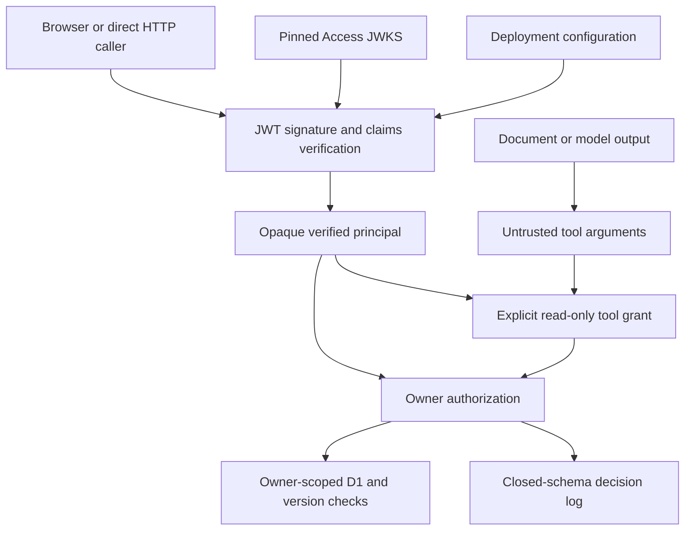

# P0-001 — Twin identity and authorization threat model

Date: 2026-11-07 UTC. Scope: Twin HTTP APIs, account-scoped D1 state, future memory-tool interface, and security logging. The independent source review examined baseline `d143a9eefd90925e16ff572a54ed08338b795014`. This is not a security assessment of the unrelated Ballast applications or of the private Sites infrastructure.

## Assets, actors and boundaries

Assets: confirmed/suggested memories, documents, tasks, profile/AI-consent state, account ownership, deletion integrity, version counters, authentication assertions, and model API credentials.

Potential attackers: anonymous Internet clients; another legitimate user; a malicious document or LLM output; someone replaying a stolen assertion; a compromised tool implementation. Deployment operators, IdP administrators, trusted application code, D1 access administrators, and the configured issuer's signing keys are inside the trusted computing base.

A document or model can propose arguments, but cannot create an identity, change policy, supply an owner, mint a capability or select signing keys. The tool grant is held by trusted server code, never derived from document text or an LLM response. D1 returns only the authenticated owner's account row. Stored item IDs are resolved inside that row.

## Attacks and controls

| Attack                                          | Preconditions and impact                                                                                                                                                             | Severity                             | Candidate control and evidence                                                                                                                                                                                                                                                                                                     |
| ----------------------------------------------- | ------------------------------------------------------------------------------------------------------------------------------------------------------------------------------------ | ------------------------------------ | ---------------------------------------------------------------------------------------------------------------------------------------------------------------------------------------------------------------------------------------------------------------------------------------------------------------------------------- |
| Forged Sites/user/email headers                 | Attacker reaches an ingress that forwards unsigned identity headers and knows a victim ID; arbitrary read/write/deletion at baseline. Actual live direct-origin exposure is unknown. | Critical, conditional on ingress     | Ignore all unsigned identity headers; require configured Access JWT on all three API operations. Node and workerd tests send spoofed identities, including alongside another user's valid JWT.                                                                                                                                     |
| Missing, malformed, expired or altered JWT      | Public endpoint accepts an unauthenticated or modified assertion.                                                                                                                    | High                                 | Signature and required claims validated by jose; compact-format/size bounds; generic 401; no D1 activity. Negative cases exercised through every route.                                                                                                                                                                            |
| Wrong issuer, audience, algorithm or token type | Token issued for another app/team, an unsigned token, HS256 confusion, global session or service token.                                                                              | High                                 | Pinned issuer/AUD/RS256/type, nonempty subject, required expiry/issue/not-before. Unknown signing keys deny.                                                                                                                                                                                                                       |
| Token-directed JWKS/SSRF                        | Caller embeds attacker keys/URLs or controls request host.                                                                                                                           | High                                 | Derive the sole HTTPS JWKS URL from deployment configuration; reject token key references; jose uses manual redirect handling. Network assertions test only the pinned endpoint.                                                                                                                                                   |
| Cross-user memory/profile/task access           | Authenticated user supplies victim owner/record IDs in URL, body, claims or headers.                                                                                                 | High                                 | Identity-derived owner only; exact action allowlist; item lookup inside own state; D1 owner conditions. Tests cover reads, updates, confirmation, deletion, recall and account erase.                                                                                                                                              |
| Legacy account takeover                         | New provider subject/email is mistaken for an old Sites identity.                                                                                                                    | High                                 | Namespaced IDs; no email matching. Operator-only one-to-one links verified before rollout. Test preserves original legacy ID/state/version and rejects coincidental matches. Operator mislinking remains a risk.                                                                                                                   |
| Unauthorized agent tool execution               | Model supplies a tool name, permission claim, fake principal or capability.                                                                                                          | High                                 | Opaque registered principals/grants; only selected confirmed-memory read tools; strict arguments; no grant-creation HTTP route; no external-action runtime. Forged and serialized grants deny before loading.                                                                                                                      |
| Forged or replayed approval                     | Attacker edits/reuses a durable approval credential.                                                                                                                                 | High if write approvals exist        | No approval-token protocol or write tools implemented. There is no reusable approval bearer token. Process-local read grants expire within 60 seconds; cloned/serialized/expired grants deny. A genuine grant may intentionally perform multiple permitted reads during its lifetime. Stateful one-time approvals are future work. |
| Prompt injection changes authority              | Imported instructions ask for permission escalation or another user's information.                                                                                                   | High if instructions reach authority | Documents remain untrusted data; authorization ignores text and claims. Tests retrieve a malicious instruction as a cited excerpt, then demonstrate it cannot grant permissions or execute a tool. This does not establish general model resistance to misleading output.                                                          |
| Authorization race/cross-request context bleed  | Concurrent requests reuse a global principal, or concurrent writes overwrite another version.                                                                                        | High                                 | Cache only verifier configuration; request-local headers; immutable principals; D1 owner+version CAS. Tests alternate concurrent identities and require one of two competing writes to receive 409. Tool expiry is rechecked after awaits.                                                                                         |
| Gateway bypass/direct Worker request            | Attacker accesses a Worker without Access ingress.                                                                                                                                   | High                                 | Verification in route dependencies does not depend on gateway provenance; synthetic direct requests fail. Production origin inventory, network controls and ingress sanitization remain unverified.                                                                                                                                |
| Secrets/private memory in logs                  | Errors, caller input or provider responses flow into observability.                                                                                                                  | High                                 | Fixed audit schema and generic errors; no arbitrary logging context. Canary tests inspect logs for tokens, email and private memory. Host-level logging/redaction configuration requires separate validation.                                                                                                                      |
| JWT replay after theft/revocation               | Attacker steals a still-valid signed bearer JWT.                                                                                                                                     | High                                 | TLS and short issuer session lifetimes are deployment requirements; local verification enforces expiry. No online per-request session revocation check. Logout/revocation behavior must be validated against the real Access tenant.                                                                                               |

## Existing limits and exclusions

- D1 state CAS and exact deletion confirmation are preserved. Erasing an account and its AI-request ledger is still two statements; a concurrent live-AI request can race with erasure. This patch does not establish immediate cancellation of in-flight inference or atomic cleanup across those tables.
- AI quota enforcement remains a count-then-insert operation and may overshoot under concurrency. No paid inference was invoked; spend controls and transactional quotas are separate work.
- Active-record deletion does not erase provider backups or data already returned to a user/model. Existing retention behavior remains unchanged.
- A malicious operator, stolen provider signing key, arbitrary server code execution, XSS, or an intentionally mis-scoped trusted tool implementation is not contained by an in-process WeakSet. These capabilities prevent untrusted JSON/LLM input from becoming authority; they are not a sandbox for hostile code.
- No autonomous writes, external connectors, durable approvals, fine-grained sharing, or mobile authentication is enabled. Adding any requires a fresh boundary review.
- Audit entries intentionally omit actor identity. They prove decisions in tests but are not a complete actor-attributable or tamper-evident production audit system.
- Availability depends on JWKS retrieval/cache and correct provider configuration. Invalid config denies all private APIs with 503. Unknown rotated keys can fail during the 30-second cooldown; stale keys refresh after five minutes.

## Required production evidence

Before calling the boundary production-verified: record the deployed candidate SHA, actual ingress/direct-origin inventory, Access settings, two synthetic user sessions, verified legacy identity links, unauthorized/authorized request results, account isolation, retained data access, and host log inspection. Keep credentials and personal payloads out of the report. No such deployment or production identity modification is authorized in this task.
